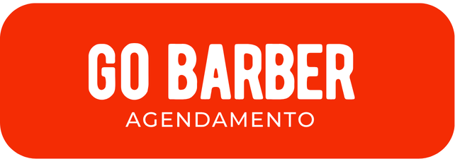

<p align="center">
  
</p>

<h3 align="center">
  Agendamento de serviços de barbearia de forma simples, rápida e sem complicação.
</h3>

<p align="center">
  
  
</p>

---

## 💈 Sobre o projeto

O **GoBarber** é um SaaS de agendamento para barbearias, usado como aplicativo web (PWA). O **cliente** encontra uma barbearia, escolhe o barbeiro, os serviços e um horário livre. O **dono e os barbeiros** gerenciam agenda, equipe, catálogo, clientes e faturamento num painel. Cada barbearia é isolada das demais e pode ter um endereço próprio (`slug.dominio`), conforme o plano.

---

## 🎯 Principais funcionalidades

### 👤 Autenticação e conta
- Cadastro, login com e-mail e senha e recuperação de senha por e-mail
- Aceite dos Termos de Uso e da Política de Privacidade registrado no cadastro
- Convite de barbeiros por e-mail para entrar na equipe da barbearia

### ✂️ Para o cliente
- Busca de barbearias por nome ou endereço, e barbearias perto de você
- Página da barbearia com barbeiros, serviços, preços, fotos e horário de funcionamento
- Agendamento em poucos passos, com horários livres calculados pela jornada e pelas ausências do barbeiro
- Pagamento em dinheiro ou em pontos de fidelidade, com saldo por barbearia
- Código de confirmação, cancelamento e histórico dos agendamentos

### 📅 Para donos e barbeiros
- Painel com indicadores, faturamento e clientes
- Agenda com finalização por código de confirmação e controle de não comparecimento
- Configuração de serviços, preços, duração, jornada, ausências, produtos e fotos
- Assinatura da plataforma com Mercado Pago: a barbearia configura tudo antes de pagar e passa a receber agendamentos com a assinatura ativa
- Guia de primeiro acesso e link da barbearia para divulgar

### 🔔 Experiência do usuário
- Central de ajuda com perguntas frequentes e ajuda contextual no painel
- Tema claro e escuro e layout responsivo
- Notificações de feedback (sucesso e erro) em ações importantes

---

## 💳 Planos

Toda barbearia pode criar a conta e **configurar tudo de graça** (serviços, preços, horários, equipe e fotos). Para
**receber agendamentos**, precisa de uma assinatura ativa. A cobrança é **mensal e recorrente pelo Mercado Pago**,
sem taxa de adesão, e pode ser cancelada a qualquer momento pelo painel.

| | **Básico** | **Profissional** ⭐ | **Premium** |
|---|:---:|:---:|:---:|
| **Preço** | **R$ 39,90/mês** | **R$ 79,90/mês** | **R$ 129,90/mês** |
| Para quem | Barbeiro que atende sozinho | Barbearia com equipe | Quem quer a própria marca na internet |
| Barbeiros | 1 | Até 5 | Ilimitados |
| Agenda online, fidelidade em pontos e painel | ✅ | ✅ | ✅ |
| Página da barbearia (link para divulgar) | ✅ | ✅ | ✅ |
| Endereço próprio (`suabarbearia.gobarber…`) | — | ✅ | ✅ |
| Domínio próprio (`www.suabarbearia.com.br`) | — | — | ✅ |
| Permissão de painel por barbeiro | — | ✅ | ✅ |
| Prioridade no suporte | — | — | ✅ |

### Básico — R$ 39,90/mês
Para o **barbeiro autônomo** que quer parar de marcar horário pelo WhatsApp.
- **1 barbeiro**, com jornada, ausências, serviços, preços e duração próprios.
- **Agenda online sem choque de horário:** o cliente vê só os horários livres e recebe um código de confirmação.
- **Página da barbearia** com serviços, preços e fotos, para divulgar no Instagram, no WhatsApp e no Google.
- **Fidelidade em pontos:** o cliente ganha pontos a cada atendimento pago em dinheiro e troca por serviços que você liberar.
- **Painel** com clientes, faturamento (dinheiro e pontos separados), produtos e estoque.

### Profissional — R$ 79,90/mês ⭐ mais escolhido
Para a **barbearia com equipe**. Tudo do Básico, mais:
- **Até 5 barbeiros**, convidados por e-mail, cada um com a própria agenda, serviços e preços.
- **Endereço próprio** no formato `suabarbearia.gobarber…`, mais fácil de lembrar e divulgar.
- **Permissão de painel por barbeiro:** você escolhe quem da equipe pode ver os números da barbearia.

### Premium — R$ 129,90/mês
Para quem quer a **própria marca na internet**. Tudo do Profissional, mais:
- **Barbeiros ilimitados.**
- **Domínio próprio** (`www.suabarbearia.com.br`), configurado junto com a equipe do GoBarber.
- **Prioridade no atendimento** do suporte.

### Incluso em todos os planos
- Funciona no navegador do celular e do computador, **sem instalar aplicativo** (PWA).
- Avisos por e-mail: convites da equipe, recuperação de senha e comprovantes da assinatura.
- Central de ajuda com perguntas frequentes para clientes e para barbearias.
- O cliente acompanha e **cancela** os próprios agendamentos e vê os pontos em "Minha conta".

### Como a cobrança funciona
- **Recorrente:** o valor do plano é cobrado todo mês até o cancelamento; o recibo chega por e-mail.
- **Seguro:** o pagamento é feito no Mercado Pago; o GoBarber não recebe nem guarda os dados do cartão.
- **Sem assinatura ativa** (pagamento recusado, pausado ou cancelado), a barbearia sai da vitrine e para de receber
  agendamentos; os dados e as configurações ficam guardados para a reativação.
- **Trocar de plano:** cancele a assinatura atual na tela Assinatura e assine o novo plano.
- **Desistência:** na primeira contratação, até 7 dias com devolução integral (art. 49 do Código de Defesa do Consumidor).

> **Para a equipe:** os preços, as descrições e os benefícios exibidos em `/planos` vêm da tabela `planos` do banco
> (editáveis na área da plataforma). Ao mudar um preço, só as **assinaturas novas** pagam o valor novo: o valor das
> existentes fica gravado no Mercado Pago, e mudar o delas exige aviso prévio (Termos de Uso). O limite de
> barbeiros por plano ainda não é aplicado automaticamente pelo sistema.

---

## 🛠 Tecnologias

- **Frontend:** [Next.js](https://nextjs.org/) 16, [React](https://react.dev/) 19, [TypeScript](https://www.typescriptlang.org/), [Tailwind CSS](https://tailwindcss.com/) 4, [shadcn/ui](https://ui.shadcn.com/) (Radix UI), [Axios](https://axios-http.com/) e [Recharts](https://recharts.org/)
- **Backend:** [Node.js](https://nodejs.org/), [Express](https://expressjs.com/), [Sequelize](https://sequelize.org/) com PostgreSQL, JWT e documentação da API com Swagger
- **Serviços:** Mercado Pago (assinaturas), e-mail por SMTP, Supabase (banco e fotos em desenvolvimento) e Sentry (monitoramento de erros, opcional)

> As tecnologias podem ser ajustadas conforme a evolução do projeto.

---

## 🗂 Repositórios da organização

| Repositório | Descrição |
| ----------- | --------- |
| `frontend` | Aplicação web (Next.js): páginas do cliente, das barbearias e o painel |
| `backend` | API REST (Express + Sequelize) |

---

## 🚀 Como executar

O passo a passo completo (variáveis de ambiente, banco e Swagger) está no README de cada repositório.

```bash
# Clone os dois repositórios lado a lado
git clone https://github.com/etkgobarber/backend.git
git clone https://github.com/etkgobarber/frontend.git

# Instale as dependências
cd frontend && npm install
cd ../backend && npm install

# Configure o .env de cada um (veja os READMEs) e suba os dois juntos, a partir do backend
npm run dev
```

O frontend fica em `http://localhost:3000` e a API em `http://localhost:3333` (documentação em `/api-docs`).

---

## 🤝 Como contribuir

1. Atualize a `main`: `git checkout main && git pull`
2. Crie uma branch para a mudança: `git checkout -b feat/minha-feature` (ou `fix/...`, `docs/...`)
3. Faça o commit das alterações: `git commit -m "feat: minha nova feature"`
4. Envie a branch: `git push -u origin feat/minha-feature`
5. Abra um **Pull Request** para a `main`

---

## 📄 Licença

Este projeto está sob a licença **MIT**. Consulte o arquivo [LICENSE](LICENSE) para mais detalhes.

---

<p align="center">
  Feito com 💈 pela equipe <strong>GoBarber</strong>
</p>
